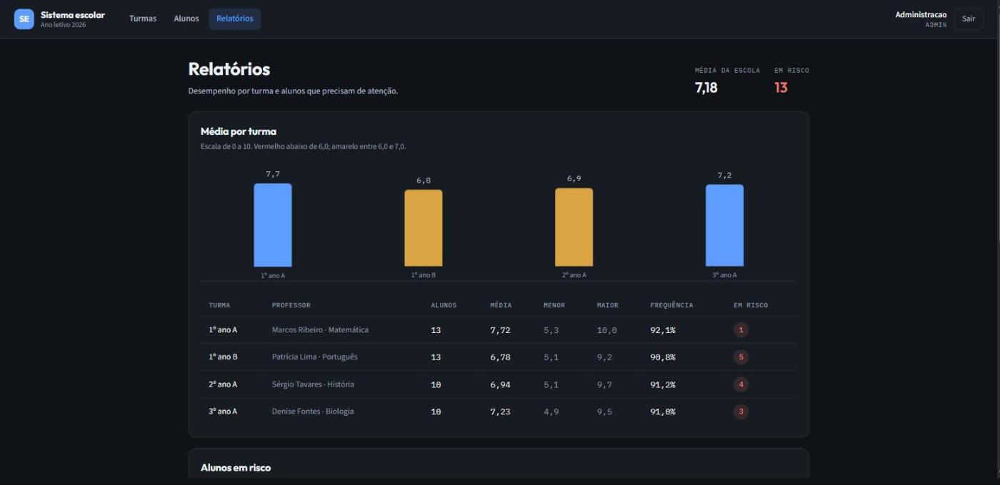

# school-app

Front-end do sistema escolar, em Angular 22. Consome a
[SchoolApi](https://github.com/Jx-dev-c/SchoolApi) — login com JWT, turmas,
alunos e relatórios de desempenho.



## O que tem

- **Login** com reactive form e sessão guardada em signals.
- **Interceptor** que anexa o token e, ao receber 401, renova a sessão uma vez
  antes de mandar para o login. O access token vive 15 minutos; sem isso o
  usuário seria expulso da tela no meio do trabalho.
- **Guarda de rota** que preserva o destino: quem tenta abrir `/relatorios` sem
  sessão volta para lá depois de entrar.
- **Turmas** com ocupação por barra; **alunos** com busca e paginação;
  **relatórios** com média por turma, frequência e alunos em risco.
- **Cada tela em chunk próprio** — quem entra como aluno não baixa o código das
  telas de relatório.

O que aparece depende de quem entrou: admin vê a escola inteira, professor vê só
as turmas dele, aluno vê as que cursa. A regra é garantida pela API; a guarda de
rota é conveniência de navegação, não segurança.

## Rodando

O sistema completo — banco, API e front atrás de um nginx só — precisa dos dois
repositórios lado a lado:

```
projetos/
├── SchoolApi/
└── school-app/     <- rode daqui
```

```bash
docker compose up -d
```

Abre em `http://localhost:8080`. O front chama `/api` no mesmo domínio, então
não há origem cruzada nem endereço de servidor dentro do bundle.

Contas de demonstração, senha `escola@2026`:

| Conta | O que vê |
|---|---|
| `admin@escola.test` | Todas as turmas, todos os alunos, relatórios da escola |
| `professor@escola.test` | Só as turmas e alunos dele |
| `aluno@escola.test` | Só as turmas em que está matriculado |

Para desenvolver só o front, com a API rodando em `localhost:5105`:

```bash
npm install
npm start
```

## Decisões

- **Signals no lugar de `Subject` + `ChangeDetectorRef`.** A versão anterior
  avisava por `Subject` e cada componente chamava `detectChanges()` na mão. Com
  signals o estado é lido direto e o Angular recalcula sozinho — e o app roda
  zoneless.

- **`rxResource` em vez de `subscribe`.** Carregando, erro e recarga saem de
  graça, e não sobra inscrição solta para vazar.

- **SSR desligado.** Estava ligado por padrão do template, sem nada que
  justificasse: os dados dependem de token e são por usuário, então não há o que
  renderizar no servidor. Desligar simplificou o deploy para arquivo estático.

- **URL da API por ambiente.** Antes era literal no serviço
  (`http://localhost:5105`), o que quebraria em qualquer publicação — o
  navegador do visitante não tem um `localhost:5105`.

- **Nginx com fallback de rota.** Aplicação de página única precisa devolver o
  `index.html` em rota desconhecida, senão recarregar em `/relatorios` dá 404.

- **Sessão em `localStorage`.** É o trade-off usual de SPA: sobrevive ao F5, mas
  um XSS levaria o refresh token. A alternativa mais segura é cookie `HttpOnly`
  com `SameSite`, que exige front e API no mesmo domínio — que é como o compose
  já entrega.

## Estrutura

```
src/app/
├── core/          sessão, interceptor, guardas e tipos da API
├── layout/        moldura com navegação por papel
└── paginas/       entrar, turmas, alunos, relatorios
```

## Limitações conhecidas

- **Não há tela de cadastro** de aluno, turma ou nota: a API aceita, o front
  ainda só lê. É o próximo passo natural.
- **A chamada de presença não existe** em lugar nenhum — a frequência mostrada
  vem dos dados de exemplo.
- **Os testes cobrem o núcleo, não as telas**: sessão e interceptor têm 11
  testes; as páginas foram verificadas no navegador, papel por papel.
